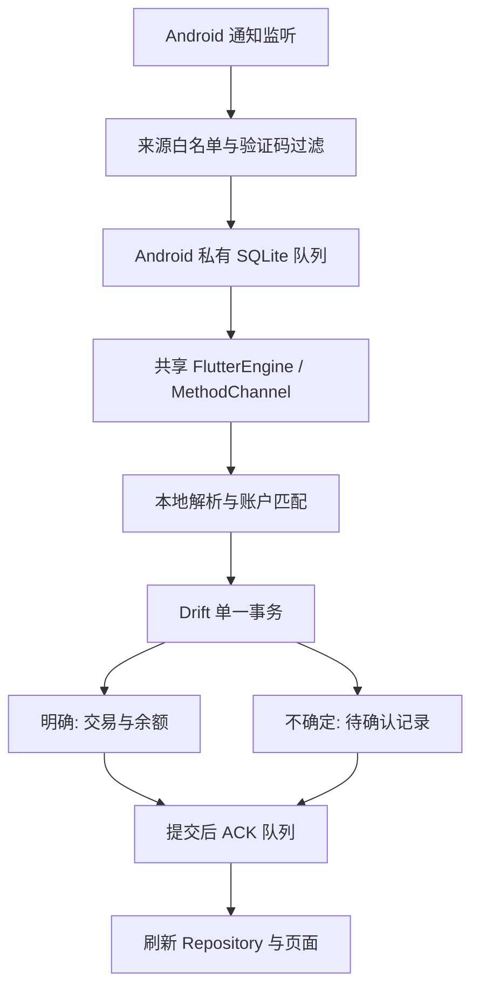

# Android 通知记账（0.11.0-dev+47）

本功能为开发版。APK 编译与自动化测试不等于银行实机验收；没有真实银行通知样本时，不承诺任何银行或钱包的识别率。公开稳定版仍为 v0.10.1。

## 使用流程

1. 在 Android“设置 → 通知记账 → 来源设置”绑定来源应用、账本账户及通知中的独有账户片段（例如 `Card: **1234`）。多个账户分别绑定；不要用常见金额或“Card”等通用词作为识别片段。
2. 打开系统通知读取授权，再开启“自动接收与记账”。授权前通知不补读。关闭开关后停止接收；已经进入队列的通知转待确认。移除最后一条绑定同时关闭接收。
3. 明确的交易进入“已处理”；疑问交易进入“待确认”，显示原因与原文，可核对金额、账户、类型、日期后保存一笔实际交易，或忽略。退款可人工确认为负支出，转账/还款需人工选择两端账户。
4. “已处理”支持撤销，删除对应交易并反向恢复余额，同时保留防重记录。若交易被手动编辑，撤销作用于其当前版本；普通交易页仍可修改自动生成的交易。
5. 完整 JSON 导出包含通知正文和防重记录，请保护备份。更换设备后重新设置来源与授权。导入历史备份、清空账本或降级前，先关闭通知接收并处理队列，避免旧队列与恢复后的账本混用。

## 自动入账契约

当前支持下列严格英文句式。示例是合成测试数据，不代表已适配任何银行：

```text
Payment of MYR 12.34 to SHOP was successful. Ref: ABC12345 Card: **1234
Paid RM 12.34 to SHOP successfully. Reference: ABC12345 Card: **1234
Received MYR 12.34 from COMPANY successfully. Transaction ID: ABC12345 Account: **1234
```

支持 MYR/RM、USD、CNY、TWD；金额为正数且含两位小数，允许千位逗号。标题出现失败/待处理等状态时不会自动入账。正文必须完整匹配句式，包含唯一金额、明确成功状态、6–64 字符交易编号。账户片段按原文区分大小写匹配，必须只命中一条绑定，且账户有效、币种一致。自动入账限现金、储蓄、电子钱包与信用卡账户。类别不猜测，保存为空，可在交易页补充。

通知送达时间暂用作发生时间，不推断正文日期；延迟超过一天的通知待确认。超过 4096 字符的正文标记截断并待确认。失败、待处理、退款、转账、还款、预授权、奖励等不能自动入账。验证码在 Android 接收层过滤，不存入队列。未知语言/模板、金额不唯一、币种不一致、无账户匹配、多个匹配、配置变化均待确认。不调用大模型，不联网解析。

防重分三层：完全相同事件 ID 幂等返回；已有同一通知的交易但凭据缺失时待确认；相同通知 key 更新或相同来源交易编号待确认；已有实际交易在通知时间前后 10 分钟内同金额同币种，也待确认。后两类不静默删除，可能只是同金额的不同消费。跨来源没有可靠统一交易 ID，依赖疑似重复提示与人工核对。

## 模块与运行流程



- `android/app/src/main/kotlin/com/financecompass/app/NotificationCapture.kt`：`PaymentNotificationListener`、`NotificationQueue`、`FinanceEngine`。Activity 与服务复用同一 FlutterEngine，避免两个 Dart 引擎持有独立账本连接。后台收到通知可启动引擎执行相同主入口，不自动打开 Activity。
- `lib/src/core/notifications/notification_parser.dart`：纯解析器，返回候选字段与人工确认原因。
- `notification_bookkeeper.dart`：接收、防重、确认、忽略、撤销；复用 AppDatabase 入账和反向余额操作，不另算一套余额。
- `notification_bridge.dart`：串行消费、提交后 ACK、失败后 30 秒及恢复前台重试、刷新 Riverpod。每个事件重新读取当前配置与系统授权，并在该事件内使用独立快照，页面并发刷新不会替换正在处理事件的账户；已开始处理的事件按该次快照完成，设置变更影响后续读取。接收后配置版本变化或授权被撤销则待确认。连接握手失败也进入重试；消费与刷新期间收到 available 会补做一次队列读取。
- `lib/src/features/settings/notification_bookkeeping_page.dart`：来源设置、待确认、已处理。确认复用 TransactionFormDialog 的 `notificationDraft` 模式，保留通知日期并禁止生成多个月记录。

## 数据、接口与失败行为

账本 schema 仍为 9，不新增财务表，不改写已有交易。每条通知存在 `app_meta` 的 `notification_record_v1_<eventId>` 中，JSON 包含 id、key、package、postedAt（Unix 毫秒）、title、text、configVersion、configurationChanged、state、reason、候选金额/币种/类型/商户/编号/账户与 transactionId。

状态：接收 → posted 或 pending；pending → confirmed 或 ignored；posted/confirmed → undone。已处理状态不自动回到 pending。交易 ID 固定为 `notification_<eventId>`。通知记录与交易/余额同事务提交，ACK 失败重试不会再次扣款，撤销保留 tombstone。人工确认再次验证有效账户、币种、非零有限金额、实际状态、转账目标及金额；重复确认报错，不重复写入。

Android 队列 `notification_capture.sqlite` 的 events 表为 `id TEXT PRIMARY KEY, payload TEXT NOT NULL`。SHA-256 ID 基于通知 key、postTime、标题与完整正文。每批最多 50 条，成功后逐条 ACK；原生队列不包含在 JSON 备份。配置保存在私有 SharedPreferences `notification_capture/config`，包括 enabled、bindings、递增 version，不进入账本 JSON，跨设备不自动启用。捕获保存失败尝试保存 captureFailed 标记，在页面提示核对账单；日志不输出通知正文。

连接握手、消费队列、Repository 刷新、记录列表读取均纳入同一恢复流程：失败显示状态并在 30 秒后重试，也可手动刷新或恢复前台触发。未提交/未 ACK 的事件保留在原生队列；已 ACK 但 Repository 刷新失败时，保留本进程待刷新标记，下次重试只需重载账本，不重复入账。桥接对象销毁后不再通知页面或继续消费，已提交但未 ACK 的事件由下一次连接幂等恢复。

MethodChannel：`finance_compass/notification_bookkeeping`。Dart 调用 ready、config、configure(JSON 字符串)、permission、captureFailed、openPermission、apps、pending、ack(eventId)；Android 发 available 唤醒消费。apps 只查询可启动应用，不请求 QUERY_ALL_PACKAGES。服务要求 BIND_NOTIFICATION_LISTENER_SERVICE 系统绑定权限；用户必须单独开启通知读取，普通发送通知权限不能替代它。

记录默认持续保留，暂无自动保留期或批量清除正文入口。完整 JSON 备份包含记录；AI 摘要不含通知原文，已记账交易仍参与现有财务分析。清除应用数据/卸载会丢失私有队列与设置。旧版不会显示新记录；回滚前关闭通知权限，优先用升级前 JSON 恢复。Debug 使用 `.debug` ID，与正式版数据隔离，不需要卸载正式版。

## 验证与限制

自动化覆盖严格句式、拒绝不确定内容、原子余额、防重/更新、忽略、撤销、回滚、ACK 重试、连接握手与 30 秒自动重试、逐条撤权检查、刷新失败恢复、刷新期间通知唤醒、销毁时队列保留、并发设置刷新下账户隔离、人工确认、隐私导出、暂停，以及 375px 小屏、横屏、平板和两倍字号。最终构建与测试结果见[变更记录](CHANGELOG.md)。

真机验收尚未完成：授权/撤权、进程回收后新通知、锁屏隐藏正文、银行模板、厂商省电策略、后台到前台引擎复用、重启恢复和屏幕阅读器。系统强制停止、后台限制或来源不发通知都可能漏记，不保证与账单完整一致。新增银行适配必须先取得脱敏成功、失败、重复、退款、多账户样本，并添加回归测试。

## GitHub 回滚基线

修改前快照分支 `codex/backup-before-notification-2026-10-17`，提交 `857bc56ba132fd8341af67d2cedd7ee62ec7a7ba`；稳定标签 v0.10.1 保留。快照含修改前源码与既有目录清理记录，不含被忽略的财务备份和签名密钥。
