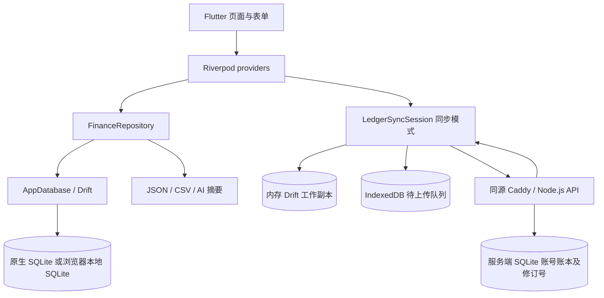

# Finance Compass 系统架构

Finance Compass 共用 Flutter 界面、Riverpod 状态和 Drift 业务数据层。原生应用和静态 Web 使用设备本地账本。启用 `FINANCE_SYNC_WEB` 的 Web 构建提供账号同步，也可进入独立的浏览器本地模式。部署文档见[静态自托管](SELF_HOSTING.md)和[账号同步](SYNC_HOSTING.md)。

公开分发层由 Flutter Android Release、Flutter Windows Release、Inno Setup 安装器、便携 ZIP 及可自托管的 Flutter Web/PWA 组成。`pubspec.yaml` 负责版本与静态支持二维码资产，Android Gradle 配置从被 Git 忽略的本机 `key.properties`/JKS 读取稳定发布签名，Windows CMake 输出 `FinanceCompass.exe`，`packaging/windows/FinanceCompass.iss` 只包装同一次 Windows Release 目录。`deploy/selfhost/` 用 Docker 多阶段构建 Flutter Web，再用 Caddy 仅提供静态文件；它没有 API、服务端数据库或同步。GitHub Release 只接收二进制与校验文件，不接收数据库、JSON 备份或签名密钥。

## 技术栈

同步版 Web 29 的内置 AI 聊天从总览或报表进入，经同源 SSE 连接同步服务。主题门控放行后，服务端读取会话绑定账号的一个账本修订版，生成财务摘要并提供五项只读工具。浏览器只发送问题与有限历史。网关配置属于部署环境，账本中为外部 AI 导出保存的地址不会决定聊天流量的去向。数据边界见[模块设计](MODULE_DESIGN.md#同步账本-ai-查询链路)。

- Flutter 3 / Dart 3，Material 3
- Riverpod：数据库、Repository 和 mutation 状态传播
- Drift + SQLite：本地持久化，当前 schema 版本为 9
- `file_picker`、`share_plus`：导入、导出与外部 AI 分享
- Drift WASM + OPFS/IndexedDB：Web 的浏览器本地 SQLite；`web/sqlite3.wasm` 和编译后的 `drift_worker.js` 必须同源提供
- Web 渲染：CanvasKit 随站点提供（`--no-web-resources-cdn`）。正文使用应用包内的字型，缺字时由同源回退字体补齐。重要状态标记优先用组件绘制，图标沿用 Flutter 图标资源。PWA 的现行 Worker 提供同版入口与资源；新版下载到独立缓存，用户确认后切换。首次安装和关闭所有页面后的自然激活沿用浏览器行为。

## 运行结构

原生通过 `NativeDatabase` 使用私有 SQLite 文件。浏览器本地模式通过 `database_connection_web.dart` 打开按站点和浏览器 profile 隔离的 Drift WASM 数据库。`deploy/selfhost/` 只交付静态资源。`deploy/sync/` 还包含独立的 Node.js 服务，Caddy 把同源 `/api/sync/v1/*` 代理到该服务。登录模式用 `sync_database_web.dart` 创建每标签页的内存工作副本，复用同一个 Drift schema v9。

Repository 和数据库负责交易入账、余额保存及财务统计。同步会话在确认本机待上传数据已写入后发布界面状态。服务器保留按账号划分的完整快照及修订号。余额语义见[账户余额的计算与保存](DATA_DESIGN.md#账户余额的计算与保存)，写入及冲突见[同步数据与并发](SYNC_HOSTING.md#数据与并发)。

`HomeScreen` 提供总览、账户、交易、预算、报表和设置六个主入口。页面通过 `financeRepositoryProvider` 读取不可变快照，通过 mutation providers 执行写入；写入后重新载入 Repository，避免页面持有过期数据。

Repository 对报表提供实际现金读模型，只累计 `ReportGroup.cash` 两端增减。`ReportsV2Screen` 在同一页展示所选期间的净资产变化、实际现金流及按交易发生日统计的支出分类；当前资产构成、投资净投入和本月预算分别标注自己的时点。现金流使用 `actualCashFlowSummaryForMonths`，分类排行使用 `CategoryReportIndex` 的同层子树小计，预算继续采用消费发生口径。这样信用消费和现金还款不会重复计入现金流，结构化贷款月供也不会被目标本金入账抵消成利息差额。

交易页本月及未来月份的中间口径卡使用只读派生模型 `MonthlyFundingNeed` 回答所选月份需要准备多少现金，取代旧现金收付净额卡而不再建立第二张独立大卡。Repository 先复用实际现金读模型取得已知流出，再按信用卡还款日与贷款摊销计划找出当月到期义务，并以对应还款交易计算覆盖额；总额只加入未覆盖部分，因此已有实际或预计还款不会重复计算。该模型是全月规划指标，不接收交易页下方账户、类型或类别筛选。历史月份的同一张卡按当前筛选和预计开关显示流出，并列出流入作为明细。

Repository 对信用卡提供两条明确分离的读取路径：账单、未出账和还款状态使用带日期截止的余额与交易快照；卡详情的承诺欠款和额度使用读取已影响物化余额的全部 `actual`/`settled`，从而包含未来已锁定额度的分期并排除 `planned`。两条路径分别由 `creditCardBillingSummary` 与 `creditCardOutstandingBalance` 集中提供，账户页信用卡行与信用卡详情不再各自拼装余额和截止时间，避免同一“当前欠款”在不同页面出现不同数值。实时账期摘要以参考日日终读取余额，历史账期摘要则以同一精确截止时刻过滤交易并读取余额，保证历史视图不会混入截止后的同日记录。欠款下限为 0 会把溢缴贷方余额排除在负债外，因此 `creditCardCreditBalance` 作为对称读模型提供正余额部分，用于说明卡的贷方余额。三页净资产采用同一月末的资产负债表，信用卡与贷款溢付计入资产。资产目标只汇总非信用资产。周期规则保存后由 Repository 自动展开未来 3 个完整日历月，生成器只处理今天之后的发生日并统一写入 `planned`，因此不会提前改变真实余额；规则管理可继续补齐更远月份。规则 ID 与名义月份共同标识实例，生成、种子关联及月份标记在同一事务提交。

贷款计划采用派生模型：`Account` 分别保存合同开始日、开始记账日和合同条件，并以 `initial_balance` 保存本账本开始追踪时的贷款余额。`loan_amortization.dart` 以纯函数生成 `LoanAmortizationSchedule`；当开始余额小于合同金额时，只派生开始记账日之后需要追踪的期数，不制造以前已经还款的交易。摊销表由合同条件即时推导。用户主动生成预计还款时，每期另外保存一笔 `planned` 结构化转账。用户确认某期还款时，页面通过 transaction mutation 写入一笔结构化月供转账：`amount` 是现金账户扣除的完整月供，`to_amount` 是贷款账户减少的本金，差额为利息。跨币种时利息按合同币实付额减本金计算。交易、模板和周期规则携带显式期号，SQLite v9 将该关联保存于同一事务的元数据。Dart 和 Node 分别按分累计本期本金与利息；旧版拆分资料保留原流水，并只对有证据的配对记录归属。

历史信用卡账期本身不是持久化快照，而是由 `availableCreditCardBillingPeriods` 根据账户结算日和最早相关交易按月派生。选择某期后，详情页使用该期 `CreditCardBillingPeriod` 过滤交易并计算原始账单金额：该期有来源卡流水时取其净额，只有完全缺少来源流水的旧导入账期才以结算日至还款日的转入还款净额作为凭据（下限 0）；若用户已经提供银行结单完成对账，可在账户级 `app_meta` 保存按结算日索引的权威账单总额，展示时优先使用该值。权威总额只覆盖历史原始金额，不改变交易明细或实时承诺负债口径。

## 计算与状态发布

每个账本修订号对应一份 `FinanceRepository`。普通交易、还款、设置写入共用当前 Provider 的 mutation 边界。本地写入串行；托管 Web 会话在同一工作副本事务中构造完整请求，按 UTF-8 编码检查 16 MiB 上限，再持久化待传记录。超限草稿可下载或留在当前浏览器继续精简，缩小后沿用原账号与修订检查上传。详见[同步恢复](SYNC_HOSTING.md)。

余额和快照由原币账户估值模型提供。投资采用不可变观测加后续实际流水；净资产在同一月末逐账户折算一次。贷款核销按贷款和期号分别累计本金及利息。预算与分类报表共用分类树：筛选匹配整棵子树，预算由最近的生效祖先接管交易。兼容 Service 调用上述账本读模型和领域函数。缺少可信报价时保留原币，明确标记估值范围。相关公式见[数据设计](DATA_DESIGN.md)。

资产目标将账户观测与资金变化按时点合并，建立日终资产新高索引，按目标金额查首次跨越，再按请求截止时刻核对。普通财务写入构造一份新的账本快照，只有达成日或目标资料实际变化时才写目标元数据。相同修订内重用索引与历史图表数据。

## UI 架构

- `AppThemeStyle.selectableStyles` 提供黑白极简、多巴胺及苹果液态玻璃三款外观。`finance_theme.dart` 通过 `FinanceThemePalette` 提供布局共享的配色与组件样式。
- `compass_ui.dart` 提供新版页面头部、卡片、图标徽章、设置行和悬浮操作按钮。
- `HomeScreen` 挂载各 `*_v2_screen.dart` 主页面，并保留标签页工作区状态。桌面和手机共用浮动胶囊导航，页面采用响应式内容布局。
- 交易的账户、类型、类别多选筛选直接由 `TransactionsV2Screen` 的底部面板处理；报表由 `ReportsV2Screen` 在页内完整展示。原 `TransactionsScreen` 与 `ReportsScreen` 不再有入口，源码已移除。`SettingsScreen` 仍作为高级设置页使用。
- 默认风格为黑白极简。外观页可点击预览，确认后保存设备偏好。历史主题值由 `AppThemeStyle.normalize` 归一。

## 数据升级

原生应用打开 v1–v8 数据库前会建立 `finance_compass_backups/pre_v9_*` 恢复点，包含一份由 SQLite 在线备份生成的独立数据库，以及从该副本导出的逐表 JSON。两者固定在同一个已提交的读取快照。Drift 在事务内逐级升级到 v9，随后执行 `quick_check` 与 `foreign_key_check`。备份失败会阻止升级，不会修改原数据库。浏览器本地数据库执行受支持的 schema 迁移，备份使用完整 JSON 导出。同步模式从服务端快照创建工作副本。v8 增加可空贷款合同字段；v9 只增加可空 `loan_tracking_start_date`，旧贷款缺失时回退使用合同开始日，不猜测或改写余额。

模板和周期规则在独立表中维护。数据库在账户枚举解码前修复旧库非法报表分组，并在事务内标记预设迁移完成。该标记区分旧 JSON 等待导入和用户已经清空表。当前 v3 的专用数组是导入来源，空数组也有效。恢复旧库的判定方式见[数据设计](DATA_DESIGN.md#保留与回滚)。

共享 `CompassSettingsRow` 以可空 `onTap` 区分导航行与信息行：无处理逻辑时不创建 `InkWell`、不显示箭头。`interaction_wiring_test.dart` 对全部 feature 源码执行静态门禁，阻止 `_noop`、空交互回调及没有附近真实处理器的方向性图标。货币显示和应用内提醒保存在 `app_meta`，Repository 重载后由主页面统一应用，不新增后台服务。

## Android 构建变体

正式版使用应用 ID `com.financecompass.app` 和显示名称“Finance Compass”。Debug 版在 Gradle `debug` build type 中增加 `.debug` 后缀，最终应用 ID 为 `com.financecompass.app.debug`，显示名称为“Finance Compass Debug”。两个变体可以同时安装，并由 Android 分配互相隔离的数据目录；Debug 版不能覆盖或读取正式版本地数据。

## 已知边界

- 同步版 Web 通过独立部署启用用户名密码登录，使用与本地账本隔离的 Drift 工作副本和带版本检查的服务端 SQLite。默认静态版与原生版继续走本地数据库。见 [账号同步架构和部署](SYNC_HOSTING.md)。
- 贷款计划当前使用固定合同利率；浮动利率重定价、手续费、罚息和提前还款后的合同重排尚未实现。已确定的分期可以分次核销。
- 同步站点支持每台设备主动开启 Web Push。服务端按订阅时区计算信用卡结算、还款和贷款到期提醒。原生离线应用使用应用内提醒。见[系统提醒](SYNC_HOSTING.md#系统提醒)。
