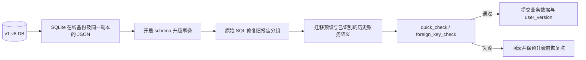

# 数据设计与迁移

金额键盘以整数分接收输入，并在计算结束时将结果舍入为两位小数。确认后回填十进制文本，外层表单仍按原金额字段类型校验和保存。原字段直接确认且未编辑时沿用旧文本，数据库与备份格式继续使用既有金额表示。

账号同步将完整 JSON v3 和修订号存入独立服务端 SQLite，客户端复用同样的业务数据模型。服务端账本与原生及静态 Web 本地账本分别存储。见 [迁移与数据并发](SYNC_HOSTING.md#数据与并发)。

## 平台存储边界

`AppDatabase` 的 schema 与 JSON 格式在原生和 Web 保持一致。原生使用应用私有 SQLite 文件。本地模式的 Web 使用 Drift WASM SQLite，数据库名为 `finance_compass.sqlite`，数据按浏览器 profile 和 origin 隔离。同步模式使用内存 Drift 工作副本、浏览器 IndexedDB 待上传队列和独立的服务端 SQLite 卷。静态自托管只有应用文件。各模式可通过完整 JSON 备份与迁移。

## 账户余额的计算与保存

阶段 2 的投资与退休账户使用下文的不可变观测。总览、账户和报表按同一月末估值，每个账户按原币余额折算一次；信用卡额度占用另计未来已确认的分期。新建普通或投资账户时，期初金额同时作为当前余额的起点。有经济流水或快照后，编辑账户资料时保护原币和物化余额。

升级前的存储和对账口径（供核对旧数据）

| 数值 | 用途与来源 |
| --- | --- |
| `accounts.initial_balance` | 建账期初余额，以账户原币保存。用于从历史流水正向追溯，也是删除唯一投资快照后重建的起点。 |
| `accounts.current_balance` | 持久化的物化余额，以账户原币保存。记账在该值上增加或撤销交易差额。任何日期的 `actual` 和 `settled` 都可以影响该值。 |
| `accountBalanceAt(accountId, cutoff)` | 指定时点的读取值。无快照时，从物化余额撤回截止时间之后的实际变动。有快照时，使用截止日之前最近的快照及适用的流水。首张快照之前从期初正向回放。 |
| 本位币汇总 | 报表和总览按账本汇率折算各口径的原币金额，折算结果用于展示和统计。 |

`AppDatabase` 在同一 Drift 事务内保存交易和涉及账户的余额。新增应用新差额。编辑先反转旧交易，再保存并应用新差额。删除反转被删除的交易。批量新增和删除同样有事务边界。收入和调整加 `amount`，支出和转出减 `amount`，转入加 `transferInAmount`。负金额照原有代数方向反转，零金额的增减为零。`planned` 只用于预计业务口径。改成实际后按新状态入账。跨币种转账使用保存的实际到账金额。结构化贷款月供的来源扣全额，目标贷款只增加本金。

普通账户的默认统计截止为当前月末，历史模式以所选月月末为截止。信用卡当前承诺欠款使用物化余额，账单、还款及到期提醒使用各自的日期边界。投资与退休账户另受下文快照规则约束。

账户表单可直接保存期初和当前余额。贷款编辑开始记账余额时保留已累计的本金变化。完整 JSON 导出同时保存两个余额字段和交易流水。导入及同步恢复从快照载入余额，兼容逻辑可对旧式同币种转账作定向归一与补正。日常记账按已有余额增量更新，因此旧差额可延续到后续交易，也可能由同步带到其他设备。

对没有快照的账户，可用 `initial_balance + 全部影响余额的流水差额` 核对物化余额。持有快照的账户按下文快照规则核对。差额表示两种口径不一致，单份导出无法证明差额何时产生或哪个值与银行对账单一致。账户的已对账月份是日期标记，余额更正需要可验证的来源。跨设备保存过程见[同步与并发](SYNC_HOSTING.md#数据与并发)。

Web 不承诺 OPFS/IndexedDB 在清除网站数据、无痕模式结束、浏览器存储配额清理、切换域名/端口或设备丢失后仍存在。任何涉及升级、迁移或导入覆盖的操作前应下载 JSON；导入验证和 Drift 事务仍沿用本文件定义的数据一致性规则。

## 活动账户、版本与显示

停用、重新启用只更改目标账户的 `is_active`。余额、已结账历史及原币保持原样。新交易和还款选择启用账户；编辑原流水时可以保留它原先的停用账户。移动端显示存储的账户名和分类名。卡号后四位没有独立数据字段，页面使用用户提供的名称；图标取保存的图标键或内置种子 ID。

完整导出中的 `app_version` 和设置页共用应用版本，格式及兼容性仍由 `format_version`、`schema_version` 定义。新建实体的主键含随机写入端标识和本地递增序列，同一微秒的并发创建仍可区分。既有主键和周期实例的确定性身份保持兼容。

## v9 实体

- `accounts`：保留 v7 的信用卡字段；v8 新增可空的 `loan_principal`、`loan_annual_interest_rate`、`loan_term_months`、`loan_start_date`、`loan_payment_day`、`loan_repayment_method`、`loan_quoted_monthly_payment`；v9 新增可空 `loan_tracking_start_date`，把中途建账日期与真实合同开始日分开。
- `categories`：新增 `icon_key`、`color_value`、`sort_order`、`is_archived`。
- `transaction_templates`：保存模板的账户、分类、金额、币种、状态、转账和显示顺序字段。拖动排序后，全部模板按当前界面顺序重写为从 `0` 开始且连续唯一的 `sort_order`；前五项由查询排序直接确定，不另建“置顶”副本。
- `recurring_transaction_rules`：保存周期、开始/结束日期、已生成月份和启用状态。
- 原有 `budgets`、`transactions`、`asset_snapshots`、`app_meta` 保留主键和数据。

`accounts.account_type` 是文本枚举，0.8.0 增加 `loan`；贷款归入 `ReportGroup.credit`。`loan_repayment_method` 允许 `equalInstallment`、`equalPrincipal`、`flatRate`。银行核定的常规月供适用于 `equalInstallment` 和 `flatRate`，不适用于每期本金固定而月供递减的 `equalPrincipal`。旧账户不会自动变更类型，旧贷款的新增字段保持 `NULL`，进入详情时提示完成条件。

## 原生数据库迁移流程

账户分组修复只写 `report_group`。投资观测和旧转账的兼容处理按下文规则核对余额。额度、账单日期与贷款合同条款缺失时保留空值。已处于 v9 的旧库也会在首次读取账户模型前完成分组及预设检查。旧版信用卡交易曾以 `record_date` 保存发生日期、以 `transaction_date` 保存单笔结算日期；一次性迁移 `credit_card_account_billing_dates_v1` 会把涉及信用卡且两者不同的 `transaction_date` 改为 `record_date`。金额、账户、分类、状态和非信用卡交易日期保持不变。信用卡编辑表单会对空字段显示额度 `10000`、结算日 `12`、还款日 `28` 的建议值，但打开页面不会写库；用户通过校验并保存后才更新对应账户。模板与规则保留原 ID。`local_profile_id` 是未来身份绑定锚点，不代表已启用云同步。

## 贷款计划派生与还款落账

贷款还款计划不设独立表。`loan_principal` 保存原合同金额，`loan_start_date` 保存真实合同开始日，`loan_tracking_start_date` 保存本账本开始追踪的截止日；负数 `initial_balance` 保存该截止日的开始记账余额，`current_balance` 保存扣除建账后本金还款的当前余额。开始余额小于合同金额即表示中途建账，不建立过去期数或历史交易。`calculateLoanAmortization` 以合同条件和可选 `openingPrincipal` 为输入，按分币四舍五入生成待追踪 `LoanInstallment` 列表；每项包含 `number`、`dueDate`、`payment`、`principal`、`interest`、`remainingPrincipal`。末期始终调整尾差，使剩余本金为零。等额本息按月余额计算利息；等额本金沿用原合同固定本金；平息贷款沿用原合同金额推导的月息，银行核定月供扣除该月息后用于冲减开始余额。

每笔结构化月供以目标贷款账户和正整数期号关联到合同。SQLite v9 在 `app_meta` 按交易、模板和周期规则的 ID 维护关联，随所属记录在同一事务更新。完整 JSON v3 在相应行携带下列可选字段。

| 字段 | 含义 |
| --- | --- |
| `loan_installment_number` | 合同期号。同一贷款同一期可有多笔实付、预计或冲正。 |
| `amount`、`currency` | 付款账户的有符号实际扣款及原币。 |
| `to_amount`、`to_currency` | 贷款账户的本金变动及合同币种，允许本金为零。 |
| `loan_payment_amount` | 合同币种的本息实付总额。跨币种必须保存；同币种可由 `amount` 得到。 |

结构化还款金额须可用安全整数分精确表示。正常还款和冲正的两端方向一致。合同币本息总额非零，本金绝对值不超过本息总额；利息是两者在合同币种下的差额。修改备注或商户、复制和套模板都会保留期号。普通转账即使恰好使用相同备注，也不会核销合同分期。

贷款详情、月度资金需求和系统提醒按贷款及期号分别累计已发生本金和利息，金额折为整数分。每个分项只抵扣到本期应付上限。冲正抵减原期的核销额，预计及尚未发生的实付不计作今日付清。生成计划时会考虑已经登记的未来付款。确认还款时按剩余金额入账，在同一事务中清理对应期次的预计记录，付款账户可以更换。剩余利息、剩余还款是各期未核销金额之和。

平息摊销把合同本金和总利息分摊成整数分，每期取相邻累计分配额之差，尾期结清剩余本金。中途建账以开账本金为可分配上限。贷款年利率保留原精度；推迟合同时联动追踪起日，避免生成早于合同的分期。

升级或导入未标记的旧资料时，只识别有目标贷款、可验证币种与金额的旧式月供，以及有唯一配对证据的旧本金与利息分录。旧拆分保留原流水，通过 `legacy_loan_id`、`legacy_loan_part_number` 记录归属。旧跨币种还款如果缺少合同币实付总额，账本不足以推断真实汇率或期号。仅编辑商户或备注时保留未分配转账的原始两端金额；修改金额需先核对。通用复制和周期模板沿用原期号，跨期月供由贷款合同计划生成。已使用显式语义的账本标识为 `loan_installment_semantics=explicit_v1`，重开或再次恢复时直接读取现有身份。升级前应保留完整备份，并统一更新同一账本的写入客户端。

## 分类选择与汇总

交易类型决定可选类别。收入和支出各自对应同类型分类；转账与调整允许转账、投资两类。历史筛选按所选类型的并集列出类别，选择父级同时匹配自身和所有后代。归档项仍可查询。从已归档的历史流水创建模板或周期规则时，可为新配置选有效分类或未分类，原流水保留原分类。新增和复制交易、预算、模板或规则时使用有效类别；编辑既有记录时保留其原有归档值或未分类状态。交易类型切换时清理不适用的分类和转账字段。

分类形成同类型的树。父级不得为自身或后代。交易、预算、模板、规则或子分类已引用的分类受类型保护。导入旧文本父级时先进行既有的名称修复或确认，再验证完整图；同步服务验证相同的父子约束。历史交易及规则通过稳定的分类 ID 保留关联，同名分类可用完整路径区分。

## 预算生效规则

`budgets` 中同一类别可以有多个不同 `month_key` 的记录，每条记录代表从该月开始生效的规则，不是只属于单月的快照。查询目标月时，系统选择 `month_key <= target` 的最新一条；更晚规则不会影响更早月份。预算编辑器仅在类别和生效月份均未改变时复用原 ID，否则创建新 ID，保留旧规则。该行为不新增 schema 或迁移。

每个类别的预算从规则生效月起继承。支出按**发生月**归入最近的有效预算祖先，优先匹配交易自己的类别。父预算承担自身及未单设预算的后代，父子额度是两个独立额度。月度总额只计算每笔实际、预计或退款一次。例：父类有餐饮预算，午餐有独立预算，午餐支出 80 只计到午餐；尚未单设预算的晚餐支出 30 计到餐饮；两项合计 110。

预算保存原币及原金额精度。编辑器的本月有效额等于该月基础额加上月实算转入。本月的开关决定向下月转出，预计下月结余还会扣本月预计支出。预览采用所选类别、月份的实际归属，下月有新规则时使用新基础额。继承月删除操作须确认要删除的源规则、生效范围以及结转可能波及的后续月份。

## 汇率缺项

汇率单位为每 1 单位原币折合多少本位币。内置报价以 MYR 为参照；使用其他本位币时，缺项通过可用的相对报价换算。例如缺少 CNY 报价且采用内置参考时，USD 本位币下 100 CNY 按 100 × 0.65 ÷ 4.7 估值。自定义记录保留币种代码，用户可在设置中补充其报价。无法定价时保留原币数额，合计标明只包含可折算部分；汇率须为有限正数。

## 周期规则和月末日期

每一期均从规则的原始年月日锚点推算。目标月缺少该日时取月末，下一期继续使用原始日号。`1/31 → 2/28 → 3/31 → 4/30` 是平年的逐月结果，闰年第二期为 2/29。批量记账、周期预览和生成共用这一运算。

同一规则 ID 与原定月份标识一个周期实例。用户将 2 月已生成的交易移到 3 月，仍然占用 2 月的名额，3 月合同实例照常生成。稳定 ID 可还原原定月份；种子和旧随机 ID 的原月存在账本元数据中，随完整备份保留。从账本中已有的未来交易创建规则时，将原记录关联到规则。补生成核对已有记录与已生成月份，规则、流水及月份标记在同一事务提交。重建同名规则沿用已占用月份；另一条不同身份的现有规则不能借改名覆盖这份历史。删除规则保留历史流水，已删除的实例也不会因普通重试而复活。编辑器明确区分未保存草稿与持久化规则。

## 资产目标统计口径

资产目标存放于 `app_meta.asset_goals_json`。每个目标保存原币金额与 `currency`。缺少币种的旧目标沿用其账本本位币，切换本位币前先固化该单位。计算进度和首次达成日时，把资产和目标换算至同一计量单位。`assetGoalSummaries` 及目标页趋势调用 `totalAssetsAt(..., includeCredit: false)`，只汇总非 `ReportGroup.credit` 账户，因此信用卡和贷款负债不扣减目标金额；`totalAssetHistory` 的 `includeCredit` 默认为 `true`，保证净资产报表继续使用原口径，只有资产目标显式传入 `false`。旧版单一目标迁移后的默认名称为“资产目标”，目标金额保留；旧的首次达成日期在展示时不再直接采用，并在下次相关写入时按现有账本重算。

截止日与首次达成日期（`AssetGoal.reachedAt`，JSON 字段 `reached_at`）：

- `assetGoalSummaries({cutoffDate})` 经 `assetGoalCutoffDate` 把缺省或晚于今天的截止日钳制到今天 23:59:59.999；早于今天的截止日按原值使用。`currentAssets`、`history` 与 `isReached` 因此都不计入未来日期的实际交易或快照，`planned` 交易本来就不影响余额。
- `reachedAt` 每次从账本重算，不读取已存储值：只检查截止日前涉及非 credit 账户的实际交易日和快照日，按日终总资产找出首次 ≥ 目标金额的那一天，而不是月末。跨月中途达成记为当天，快照升值记为快照日。
- 最早事件日之前的余额（期初余额）已达标的目标无法确认日期，`reachedAt` 为空但 `isReached` 仍为真；从未达标的目标同样为空。曾达标后回落时 `reachedAt` 保留历史首次日期，`isReached` 按当前资产为假。
- 交易、观测、账户和汇率变更后，从一份一致读取更新目标。目标复用非信用资产时间线及日终新高索引；只有目标元数据确实变化时才持久化。编辑或删除历史流水会重新确定日期，缺价时保留已有日期供恢复报价后核对。预算、分类和模板资料变更无需重新扫描目标达成日。
- 多币种历史总资产沿用现有 `convertToBase` 的当前汇率，不保存逐日历史汇率；修改汇率后，历史首次达成日期也可能随重算改变。当天尚未到时但被标记为 `actual` 的交易，按应用的日期口径计入当日日终。

## 投资快照与剩余成本

### 观测与实际流水

快照记录指定时刻的总市值和现金，均为账户原币。用户可编辑或删除观测；交易写入只更新流水和余额缓存。在表单选择一个日历日，表示当日日终。已有快照保留实际时间，同一时刻以 ID 排序选定锚点。

在任意截止时刻，取当时最近的观测，只回放观测之后至截止时刻（含）的实际流水。转账分别计算两端，自转账取两端之和。首张观测之前及尚无观测的投资账户从期初余额重放。删除唯一观测后，当前余额从期初重放全部实际流水。缓存覆盖全部已入账日期；页面按各自注明的截止日期估值。

例如 1 月快照 100、2 月快照 120、3 月转入 30，三个时点的市值分别为 100、120、150。删除 2 月快照后，3 月从 1 月观测重算为 130。补录早于 2 月快照的收入不会改变该次观测。

### 资金投入与收益

累计投入成本等于期初本金（已有首张观测时采用该观测的基准本金）加后续转入及正向调整。净投入等于累计投入成本减后续转出及负向调整，保留符号。资金净收益等于同一时点的市值减净投入；净投入为正时，收益率等于资金净收益除以净投入。系统记录资金进出和市值，没有证券份额及卖出批次。

### 旧账本兼容

SQLite 仍为 v9，完整 JSON 仍为 v3。账本元数据 `investment_snapshot_semantics=immutable_v1` 标识不可变观测。首次打开旧库或恢复缺少标记的备份时，兼容流程保留原始数值和核对依据，再按前向口径计算缓存。已转换的备份可以再次导入。无快照、无实际经济流水、期初为零且唯一有值的金额是旧当前余额时，迁移把该数值保留为开账本金。`investment_snapshot_upgrade_v1_json` 记录原字段和处理理由。旧版逐笔到账为零的普通同币种转账只在旧格式来源按兼容条件补正；结构化月供的零本金保持零。

旧版现金曾在写入时截零，非最新快照也缺乏逐笔折入记录。无法确定的历史须结合原始备份和银行或券商对账单核对。旧版自动生成的首快照未必包含真实期初本金，其基准成本只能由有依据的本金记录确认。升级或回滚时保留旧版备份。同一同步账本应先等各设备上传旧版待同步记录，再统一更新写入客户端；旧客户端仍会改写观测，服务端修订号只校验并发版本。

## 信用卡专用还款

信用卡专用还款流程只允许选择与信用账户同币种的 `ReportGroup.cash` 来源，确认后写入一笔 `actual transfer`。同币种还款以 `amount` 同时作为现金扣款和信用账户入账，`to_amount` 保持 `NULL`；它不新增消费支出，但按完整 `amount` 进入实际现金流出。

## 实际现金报表口径

报表页面由 `ReportsV2Screen` 直接读取派生数据，不新增表或迁移。旧详细报表的版块顺序曾写入 `app_meta.report_section_order_v2`；新版不再读取或修改该值，升级后旧值可留在本地，回滚至旧版时仍可使用。交易多选筛选只保存在页面状态，不写入账本或备份。

实际现金汇总是交易和账户分组的派生读模型，不新增字段。现金类账户收入为流入、支出为流出、调整按符号进入；转账分别检查来源和目标是否为 `ReportGroup.cash`。现金到信用卡或贷款的转账按来源完整 `amount` 形成现金流出，目标端本金/还款入账不与其抵消；现金账户之间的转账分别折算两端，金额相等时相抵，跨币到账金额与折算流出不等时保留净差额。信用账户消费在支付现金前不进入现金流。历史报表排除 `planned`，未来月份明确选择“包含预计”或预测时才纳入。

信用卡账期是运行时派生数据，不新增表或字段。`CreditCardBillingPeriod` 使用账户的 `statement_day`、`payment_due_day` 和当前完整日期计算 `cycleStartDate`、`statementDate`、`dueDate`、`nextStatementDate`；月底日号在短月份夹到月末。本期和未出账交易按已归一为发生日期的 `transaction_date` 完整年月日闭区间筛选，历史账期交易不得混入当前列表。`transfer.account_id` 为信用卡时，转出金额按该卡消费方向进入账单；`transfer.to_account_id` 为信用卡时，转入金额只作为该卡还款方向减少余额。信用卡 A 转至信用卡 B 因而只增加 A 的账单，同时减少 B 的负债，不在 B 重复生成消费。迁移后 `transaction_date` 只表达可编辑的发生日期；`record_date` 保留最初录入/旧版发生日期，因此用户后来修改发生日期时两者可以不同，但该差异不再代表单笔结算日期。

账单月份不新增快照表。`availableCreditCardBillingPeriods` 会先列出包含未来 `actual`/`settled` 的已确定账期，再列本期并向前逐月生成至最早相关实际交易，最多 120 期；历史中间无交易月份仍可显示为零账单。`calculateCreditCardBillingPeriodForStatement` 从所选结算日重建完整边界，`calculateCreditCardStatementAmount` 只汇总该边界内来源卡方向的实际流水并排除 `planned`；`calculateCreditCardOriginalStatementAmount` 在旧导入明细不完整时再用明确还款凭据补足原始账单额。修改交易后再次进入该月份会实时重算，不保存可能过期的账单副本。

`transactions.status` 的计算契约为：`planned` 不改变实际余额；`actual` 与兼容状态 `settled` 属于实际记录。数据库中的 `accounts.current_balance` 是为写入与回滚保留的物化值，可能包含未来日期的实际记录，因此普通账户、投资/退休和历史范围展示不得直接把它当作默认现状，而应通过 `accountBalanceAt(..., currentMonthCutoffDate())` 回退未来月份的实际变动。信用卡承诺负债是有意的例外：`creditCardCommittedOutstandingBalance` 从物化余额读取全部日期的 `actual`/`settled`，以包含已经锁定额度的未来分期；`planned` 因不影响物化余额而始终排除。信用卡本期账单、未出账、逾期与还款提醒仍使用截至今天的余额和交易列表，不能把未来承诺提前归入账期。“截至今天的余额”固定取今天 23:59:59.999：交易的 `transaction_date` 可带时刻，而账期归属只比较年月日，若以当前时刻截止，今天稍晚的消费会进入未出账却不进入欠款，使本期账单被少算。账户级“当前欠款”取 `max(0, -余额)`；正余额代表溢缴，是贷方余额而不是负债，月末净资产把正余额作为资产，负余额作为欠款，计算资产目标时排除卡与贷款。日终规则仅用于实时视图；历史截止视图以同一精确时刻过滤交易并读取余额。信用卡 `current_balance` 的存储符号保持不变：负数为欠款、正数为溢缴，账户设置表单按原符号读写，本次不迁移、不批量翻转或修正任何数据库余额。以上都是运行时派生规则，不改变 schema、`current_balance`、迁移或 JSON 备份格式。预测改用截至今天的余额为基线，再读取预测窗口内的实际与预计记录，避免本月未来交易重复累计。

周期规则保留模板交易的状态字段。周期展开统一写入 `planned`，仅生成今天之后的适用月份。用户可在发生后将其改为实际。普通新增交易的 1–12 个月批量保存会沿用表单选择的状态。

`transactions.amount` 与转账的 `to_amount` 是有限的有符号实数，不设正数约束。零金额是合法记录且不改变任何账户余额；负数按照交易类型的既有代数方向计算，例如负支出增加来源账户余额，负转账增加来源账户并减少目标账户。新增、更新和删除必须使用完全对称的正向/逆向规则。`NaN` 与正负无穷不是合法表单输入；该约束不改变 SQLite schema 或 JSON v3 字段类型。

普通同币种转账的付款金额同时用于目标入账，规范写入时 `to_amount` 为 NULL。结构化月供以显式本金为准；其中的零本金同样在导出、导入和冲正中保留。修复旧普通零到账时须先辨认旧版本语义，并核对期初、当前余额和两端流水是否能证明漏记；不确定的旧余额保留。当前格式恢复不追加已入账的金额。跨币种转账保存实际到账数，之后更改汇率不会改变原币入账。

本地账单对账修复优先使用可审计交易，不以孤立余额覆盖代替流水：缺失分期补为来源信用账户的 `actual` 支出，已确定未来分期同样使用 `actual`，全额退款以原支出和同额负支出同时保留。若银行连续账单证明差额来自应用最早可用流水之前，且无法恢复商户级明细，可校正账户 `initial_balance`，同时重建 `current_balance` 并在 `app_meta` 保存日期、银行余额、差额、删除记录及来源文件；不得伪造当前账期消费。分期交易日期按账户结算日归入对应账单，商品原购买日期保留在说明或外部账单中。写入前必须创建一致性 SQLite 备份，写入后从期初余额、实际支出及转入还款重算物化余额，并执行完整性和外键检查。

## 账户统计截止

账户统计月份是临时 UI 状态，不新增表、字段或 `app_meta`。页面把月份换算为当月最后一刻，并通过 `accountBalanceAt`、资产快照和交易日期重建历史余额；只纳入截止日前的 `actual`/`settled`，排除 `planned`。返回本月会丢弃历史选择，现有物化余额、贷款计划、信用卡账期和备份格式均不变。

## 交易删除与余额一致性

`AppDatabase.deleteTransactionsByIds` 会先去重所选 ID，再在单一 Drift 事务中读取全部记录、逆向应用每笔记录对账户余额的影响，最后删除记录。收入、支出、调整和转账沿用新增交易的反向余额规则，转账同时恢复来源与目标账户；该对称规则同样覆盖零和负金额。若实际读取数量与所选 ID 数量不一致，则抛出 `StateError` 并回滚整批操作，避免部分删除或余额只恢复一半。空 ID 集合是无操作。该流程不改变 schema、备份格式或周期规则；删除规则生成的交易不会级联删除对应规则。

## 已确定账单派生口径

`availableCreditCardBillingPeriods` 先按结算日期升序列出由未来 `actual`/`settled` 记录形成的已确定账期，再列出本期，最后按倒序回溯历史账期，合计最多 120 期。未来 `planned` 不创建账期；账期仍是运行时派生数据，不新增表或快照。

`calculateCreditCardStatementAmount` 汇总账期内来源卡方向的实际消费、转出、退款和调整。`calculateCreditCardOriginalStatementAmount` 的优先级为：权威结单覆盖值 → 该期来源流水净额 → 旧还款凭据。只要该期存在任一来源卡方向的影响余额记录（消费、转出、退款或调整，包括净额为 0 的全额退款），就以 `calculateCreditCardStatementAmount` 的净额（下限 0）为原始账单额，超额还款不会抬高账单；只有该期完全没有来源流水时，才为兼容消费明细缺失的旧导入资料汇总结算日至还款日之间转入该信用账户的实际还款，金额读取 `transferInAmount`，按已确认或已归一化的目标入账金额核算；负数转账（还款撤销）参与净额抵减，汇总结果下限为 0，与另两级的非负契约一致。还款后该值保持不变。若用户提供银行结单完成对账，`app_meta` 以 `credit_card_statement_amounts_<account_id>_json` 保存 `{yyyy-MM-dd: amount}`；`FinanceRepository.creditCardStatementAmountOverride` 校验 JSON、有限非负金额及结算日键后返回权威快照，历史列表和所选账单详情优先使用该值。该 meta 随完整 v3 导出备份，但不改变交易、`initial_balance`、`current_balance` 或实时额度。`FinanceRepository.creditCardStatementBalance` 仍表示结算日账户余额，只能用于余额审计，不再作为账单月份金额或下期已使用额度。

信用卡实时核销按卡及结算日分组。实际消费和转出增加账单，负支出、收入和贷方调整减少对应账单。转入还款按最早未结清账期抵扣，冲正可重新打开该期。跨过下一结算日后，旧欠款继续沿用原到期日；详情主金额显示最早未还一期，并列示其他未清账期。只有期初余额、缺乏历史日期证据时，从可识别的开账时点估算所属账期。

下一期已使用额度考虑已发生未出账交易、未来已确定消费及卡内剩余溢付。已结 100、实还 110、随后有已确定消费 30 时，下期净承诺为 20。只有额度为有限正数时才展示使用百分比。账单展示月份取结算日前一天，1 月 1 日结算的账单属于上一年 12 月。

## 备份与恢复

完整导出格式为 v3，包含 `format_version`、`transaction_date_semantics=occurrence_date`、应用/schema 版本、账户（包括 v9 贷款条件）、分类、预算、交易、快照、模板、周期规则和可导出的 meta 设置。导入 v1/v2 时缺失字段使用 `NULL` 或安全默认值，并执行旧信用卡日期归一；v3 资料保留用户修改后的发生日期。旧 JSON 中的模板和规则会迁入新表。原生正式导入前自动导出当前 v3 恢复点。浏览器导入前可主动保存现有账本 JSON。

交互偏好使用 `app_meta`，不改变客户端 schema。`currency_symbol_style` 为 `symbol` 或 `code`，`number_separator_style` 为 `comma_dot` 或 `space_comma`。`notifications_enabled` 与 `notification_preferences_json` 同时控制已同步的账本偏好和相应的应用内提醒；列表索引 0、1、6 分别控制信用卡还款、结算和到期当天通知。`loan_payment_push_enabled` 控制贷款推送，缺省启用。VAPID 密钥、设备订阅及去重记录分别存储于服务端 `push_vapid`、`push_subscriptions` 和 `push_deliveries`，独立于 JSON 账本。

完整导入先拒绝 0 KB、损坏、未知格式版本或字段类型错误的 JSON，再校验账户、类别、预算、交易、快照、模板与周期规则 ID 的唯一性和引用完整性。验证通过后才在数据库事务中替换所有受管表，并在提交前执行 SQLite `quick_check` 与 `foreign_key_check`；任一步失败都会回滚，原 repository 快照继续有效。模板的 `sort_order` 和周期规则的 `is_active` 会随 JSON 往返保留。导入旧 JSON 时，涉及信用卡的交易会在写入阶段把 `transaction_date` 归一为 `record_date`，因此旧单笔结算日期不会重新进入账期计算。原生自动恢复点保存在应用文档目录，不会覆盖用户选取的源文件。

手动导入会先检查旧分类的 `parent_id`。存在的 ID 原样保留。无法按 ID 定位时，只有备份中存在同类型、同名的唯一分类且不会成环，才会恢复为其 ID。其余情况必须通过导入预览确认，才能移除失效关系并保留该分类为顶层。分类 ID、交易和预算引用不变。预览和导入使用同一份文件字节。服务端同步数据仍按 ID 严格验证。

## 保留与回滚

当前数据表是模板与规则的唯一运行期来源。`preset_tables_authoritative_v1` 记录迁移完成。老格式缺少专用数组时可读取对应历史 JSON；v3 显式数组（包括空数组）优先。旧原生库里无法证明应恢复的内容，以及无法解析的旧预设，保留原始文本于 `legacy_preset_recovery/<旧键>` 供人工核对，不会自动重新激活。升级回滚使用 `finance_compass_backups/pre_v9_*` 中已验证的一致 SQLite 副本。逐表 `snapshot.json` 用于核对，应用内恢复使用完整 v3 导出。
